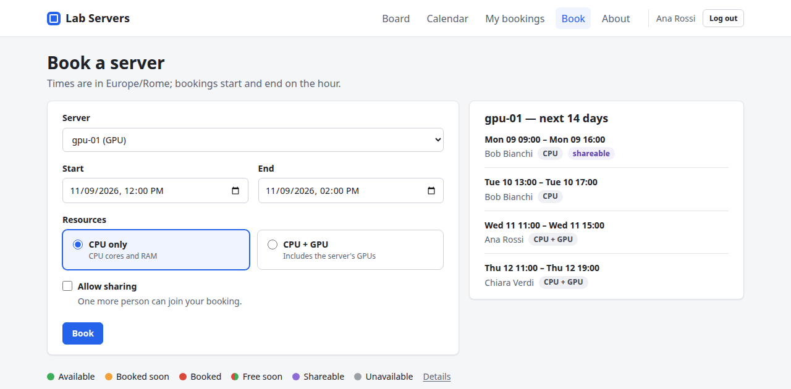
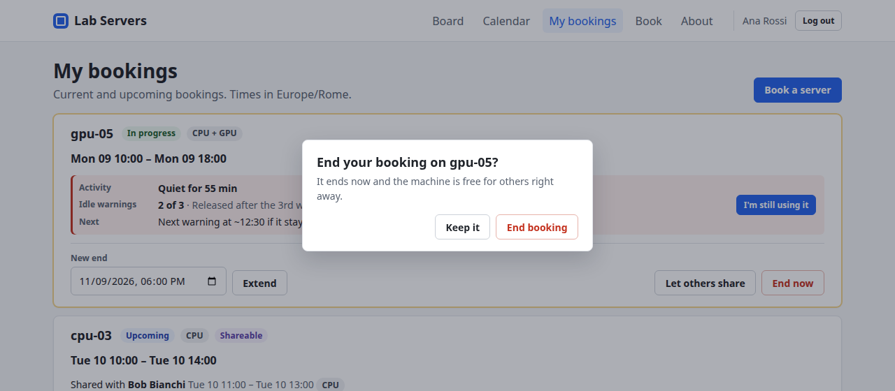
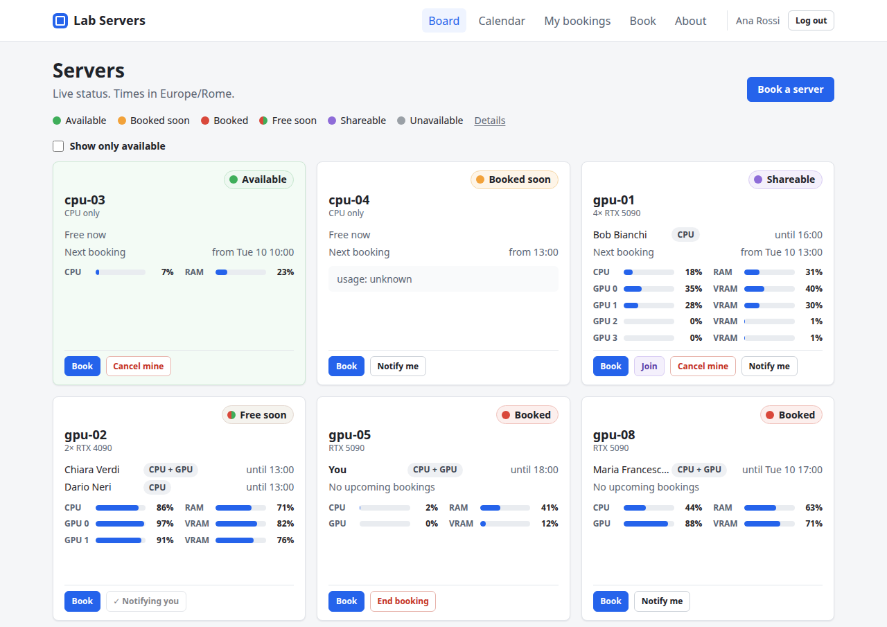
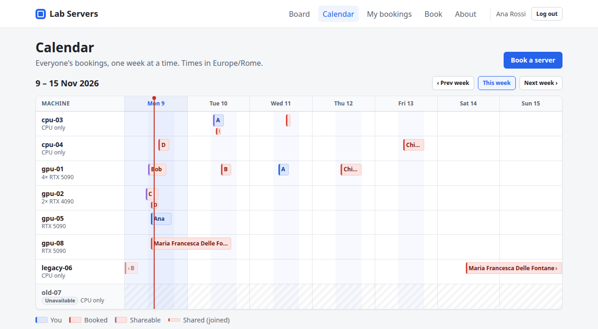
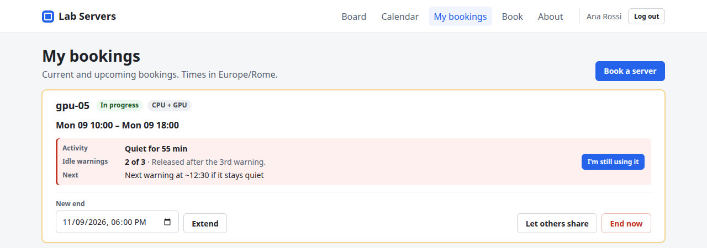

# Lab Servers — how it works

Lab Servers is where you book the lab's machines, see who is using what, and get told when a machine is free. Book before you use a machine; a booking is your claim on it for that time.

## Logging in

You log in with your Telegram account, no password. You need to be a member of the lab's Telegram group.

1. Open the Lab Servers page and press **Log in with Telegram**.
2. Telegram opens a chat with the lab bot. Tap **Start** if asked, then **Yes, log me in**.
3. Go back to the browser tab: it logs you in by itself.

The limits below are the defaults. The admins can change them; the **About** page always shows the current values.

## Booking a machine

Pick a machine and a time on the **Book** page; bookings run in whole hours, up to 14 days at a time.

- **What you will use:** choose **CPU** or **CPU + GPU**. Either way the whole machine is yours; it tells others what you are running.
- **Forgot to book?** A booking can start up to 24 hours in the past, as long as nobody else had the machine then.
- **Allow sharing:** tick it if one more person may use the machine with you (see Sharing below).
- **Change it later** from **My bookings** or from your machine's card on the board:
  - **Extend** to keep it longer.
  - **End now** when you are done: the machine is free for others straight away.
  - **Cancel** a booking that has not started yet.

Ending and cancelling ask you to confirm first.

Your bookings also appear in the lab's Google Calendar.

## The board and the calendar

The **Board** shows every machine with its status, who is using it, until when, and its live CPU, RAM and GPU use. It updates by itself when anyone books or ends a booking.

| Colour | Status | Meaning |
| --- | --- | --- |
| Green | Available | Free now, and no booking starts within 3 h |
| Orange | Booked soon | Free now, but a booking starts within 3 h |
| Red | Booked | In use by a booking |
| Red to green | Free soon | In use, but free again within 3 h |
| Purple | Shareable | In use, one more person can join |
| Grey | Unavailable | Switched off by an admin; can't be booked |

- Tick **Show only available** at the top to hide busy machines.
- **Notify me** on a busy machine sends you a Telegram message once nobody is using it. The button then reads **Notifying you**; you can stop it under My bookings.
- The **Calendar** shows everyone's bookings for a week, one row per machine. Your own bookings are in blue.

## Sharing a machine

A booking can let one more person use the same machine, at most two people at once.

- **To share yours:** tick **Allow sharing** when you book, or press **Let others share** under My bookings. You get a Telegram message when someone joins.
- **To join someone's:** press **Join** on a purple card. You borrow time inside their booking, so your time ends when theirs does.
- If the main booking ends early, the person who joined keeps the time they booked.

## Idle machines

A booked machine left quiet during working hours is given back to others, after warnings. This keeps machines from sitting booked and unused.

- **Quiet** means CPU under 10% and every GPU under 5%. Any CPU or GPU activity counts as use, whatever you booked.
- After 2 quiet hours during working hours (Mon–Fri 09:00–19:00), you get a Telegram warning. It counts from the start of your booking.
- Each warning has an **I'm still using it** button, which resets the count. The same button is on My bookings.
- After 3 warnings the booking is released and the machine becomes free.
- **My bookings** shows how long your machine has been quiet, how many warnings you have had, and when the next one would come.

You also get a Telegram message if your machine's RAM, or one of its disks, gets 90% full during your booking.

## The Telegram bot

The lab bot answers questions in the group topic and in a private chat. Type **/** in Telegram to see the commands.

| Command | What it does | Where |
| --- | --- | --- |
| /status | All machines and who is using them | Group or private |
| /status gpu-05 | One machine, including how long it has been quiet | Group or private |
| /free | Machines free right now | Group or private |
| /notify gpu-05 | Message me when gpu-05 is free | Group or private |
| /book | Book a machine, starting now | Private chat only |
| /mybookings | Your bookings: extend, end or cancel | Private chat only |
| /help | What the bot can do | Group or private |

The bot only messages you privately when something concerns you: a reminder 30 minutes before your booking starts and 1 hour before it ends, someone joining your booking, an idle warning, a RAM or disk alert, or a machine you asked about is free. The group topic only gets a short note when a machine becomes free.
